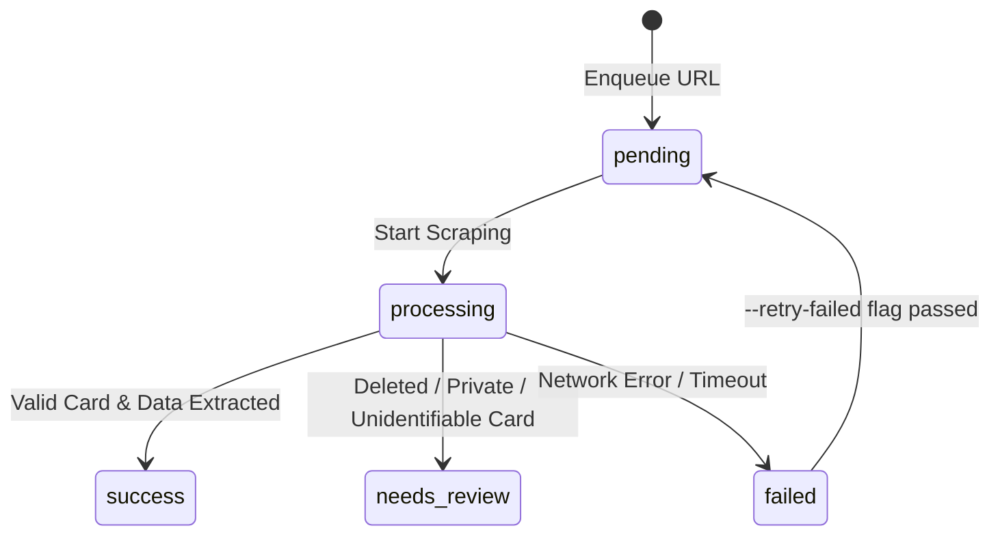

# Facebook Social Listening & Dataset Extraction Pipeline

A production-grade, automated, and resumable social listening crawler for extracting Facebook posts, interaction metrics, verified timestamps, author metadata, and sports categorizations into a strict 17-column dataset format.

Built with **Python**, **Playwright**, and **CloakBrowser** (stealth anti-detection browser engine) on macOS.

---

## Table of Contents
1. [Project Overview](#project-overview)
2. [Key Capabilities & Technical Features](#key-capabilities--technical-features)
3. [The 17-Column Dataset Specification](#the-17-column-dataset-specification)
4. [Project Structure](#project-structure)
5. [Prerequisites & Authentication Setup](#prerequisites--authentication-setup)
6. [Command-Line Interface (CLI) Usage](#command-line-interface-cli-usage)
7. [Resumption & Task State Management](#resumption--task-state-management)
8. [Automated Verification & Unit Testing](#automated-verification--unit-testing)
9. [Output Artifacts & File Formats](#output-artifacts--file-formats)
10. [Troubleshooting & Best Practices](#troubleshooting--best-practices)

---

## 1. Project Overview

This project provides an automated pipeline designed to convert unstructured Facebook posts—either sourced from an arbitrary URL list (TXT/JSONL/CSV) or dynamically discovered from Facebook Pages—into standardized, schema-compliant datasets for social listening analysis.

The architecture addresses common failure modes in social media scraping:
- **Obfuscated Facebook DOM:** Prevents zero-width character noise and dynamic class naming from corrupting captions and metrics.
- **Accurate Container Scoping:** Uses DOM traversal anchored on semantic containers (`div[data-ad-preview="message"]` and post toolbars) to ensure comments, sidebars, and recommendation posts never bleed into the main post caption.
- **True Hover Timestamps:** Uses automated mouse positioning to hover over post permalinks, triggering Facebook's native tooltip (`[role="tooltip"]`) to extract exact date-times with timezone offsets.
- **Robust Multi-Lingual Normalization:** Handles diverse numbering formats (`1.2K`, `1,2K`, `1.234`, `1,2 nghìn`) and standardizes sports terminology across English, Spanish, Vietnamese, and French.
- **Transactional Resumption:** Powered by an embedded SQLite database that tracks task statuses (`pending`, `processing`, `success`, `needs_review`, `failed`), enabling interruption and seamless resumption without duplicate web requests.

---

## 2. Key Capabilities & Technical Features

- **Anchor-Free Extraction:** Automatically discovers and extracts the complete post caption without requiring hardcoded keywords or pre-entered snippet sentences.
- **"See More" Expansion:** Automatically detects and triggers multi-lingual expanders (*"See more"*, *"Xem thêm"*, *"Ver más"*, *"Mehr anzeigen"*, *"Voir plus"*) strictly within the active post card.
- **Isolated Metrics Extraction:**
  - `like_count`: Captures total aggregated reactions (Like, Love, Care, Haha, Wow, Sad, Angry) from summary badges, distinct from the interactive Like action button.
  - `comment_count` & `share_count`: Extracted independently from footer summaries; explicitly recognizes zero-evidence states (e.g., `"No comments yet"` $\to$ `0`).
- **Author & Follower Resolution:** Automatically navigates to the author's public profile/page tab to record the verified follower count (with caching by author handle).
- **Stealth Browser Session:** Runs on `CloakBrowser` with persistent fingerprint seeds (`12345`) and safe lock cleanup (checks process PID before removing `SingletonLock`).
- **Checkpoint / Login Detection:** Halts gracefully and preserves database state if Facebook prompts for a login checkpoint or captcha.

---

## 3. The 17-Column Dataset Specification

The final exported dataset strictly implements the 17-column schema specified in `sources/dataset_requirements.xlsx`. All secondary technical metadata (such as time precision, approximate count flags, and review reasons) is stored outside this primary schema in debug bundles.

| # | Column Name | Type | Description & Business Rules | Example Value |
|---|---|---|---|---|
| 1 | `post_id` | String | Unique Facebook post identifier (canonical string or numeric ID). | `"pfbid08xPjdDRwefEd..."` |
| 2 | `platform` | String | Static social media platform identifier. | `"Facebook"` |
| 3 | `text` | String | Clean, full post caption. Excludes comments, author handles, and navigation text. | `"Las 12 campanadas del atletismo..."` |
| 4 | `published_at` | String / null | Standardized ISO 8601 timestamp with timezone. Extracted via native tooltip. | `"2022-12-29T22:32:00+07:00"` |
| 5 | `collected_at` | String | UTC ISO 8601 timestamp recording the exact time of observation. | `"2026-10-15T18:01:25.641659+00:00"` |
| 6 | `author_id` | String | Page handle, username, or profile ID of the publishing account. | `"atletismoRFEA"` |
| 7 | `language` | String | Detected language code (`"en"`, `"es"`, `"vi"`, `"fr"`), or `"unknown"`. | `"es"` |
| 8 | `hashtags` | Array[String] | List of hashtags extracted directly from the post text. | `["#42KValència", "#Maraton"]` |
| 9 | `mentions` | Array[String] | List of account mentions (`@handle`) extracted from the post text. | `["@maratonvalencia"]` |
| 10 | `like_count` | Integer / null | Total reaction count across all emotion types. Null if not displayed. | `44` |
| 11 | `comment_count` | Integer / null | Total comment count. Recorded as `0` only when explicit evidence exists. | `2` |
| 12 | `share_count` | Integer / null | Total share count. Recorded as `0` or `null` when not displayed. | `6` |
| 13 | `view_count` | Integer / null | Public view count (applicable to Video and Reel formats; null for static posts). | `null` |
| 14 | `media_type` | String | Primary media attachment type (`"image"`, `"video"`, or `"text"`). | `"image"` |
| 15 | `author_followers` | Integer / null | Number of followers of the publishing author/page at time of scraping. | `88000` |
| 16 | `post_url` | String | Canonical permalink URL of the post. | `"https://www.facebook.com/atletismoRFEA/posts/..."` |
| 17 | `sport_category` | String / null | Standardized sport category classification (e.g., `"Athletics"`, `"Football"`). | `"Athletics"` |

---

## 4. Project Structure

```text
playwright-demo/
├── facebook_pipeline.py          # Unified CLI entry point & SQLite pipeline orchestrator
├── facebook_dataset.py           # Core extraction engine, DOM parsing, & normalization logic
├── cloak_facebook_discover.py    # Autonomous Page/Feed URL discovery tool
├── cloak_facebook_login.py       # Interactive authentication & session keeper
├── cloak_facebook_posts_auto.py  # Standalone automated crawler (secondary runner)
├── cloak_facebook_posts.py       # Legacy anchor-assisted extractor (regression testing)
├── facebook_sports_30_urls.txt   # Valencia Marathon 2022 test dataset (30 target URLs)
│
├── tests/
│   └── test_local_units.py       # Comprehensive unit test suite & DOM fixture isolation test
│
├── profiles/
│   └── facebook/                 # Persistent Chromium profile data (cookies & sessions)
│
├── sources/
│   └── dataset_requirements.xlsx # Reference spreadsheet defining the 17-column specification
│
├── output/                       # Generated datasets, logs, and database files
│   ├── facebook_pipeline.sqlite  # SQLite state tracker for resume and attempt auditing
│   ├── facebook_pipeline_records.jsonl # Incremental streaming append log
│   ├── facebook_dataset_auto_*.json    # Final standardized 17-column datasets
│   └── facebook_posts_auto_debug_*.json# Comprehensive technical debug bundles
│
└── legacy/                       # Historical prototype scripts and initial experiments
```

---

## 5. Prerequisites & Authentication Setup

### System Requirements
- **OS:** macOS (Apple Silicon or Intel)
- **Python:** 3.10, 3.11, 3.12, or 3.13
- **Dependencies:** `playwright`, `cloakbrowser`

### Setup Instructions
1. **Activate Virtual Environment:**
   ```bash
   source .venv/bin/activate
   ```
2. **Install Required Packages:**
   ```bash
   pip install -r requirements.txt  # or: pip install playwright cloakbrowser pytest
   playwright install chromium
   ```
3. **Authenticate Facebook Profile (One-Time Setup):**
   Run the interactive login script in headed mode. Complete any 2FA or device approvals in the browser window:
   ```bash
   python3 cloak_facebook_login.py
   ```
   The authenticated cookies and storage state are saved to `profiles/facebook`. Subsequent automated scripts will reuse this profile headlessly or headed.

---

## 6. Command-Line Interface (CLI) Usage

The primary entry point is [`facebook_pipeline.py`](file:///Users/dipedetran/Documents/GW/GW_ARL/SocialListening/playwright-demo/facebook_pipeline.py).

### Option A: Process URLs from a File (TXT, JSONL, or CSV)

#### 1. Running from a Plain Text List
Reads one URL per line (ignores blank lines and lines starting with `#`):
```bash
python3 facebook_pipeline.py --urls facebook_sports_30_urls.txt
```

#### 2. Running a Subset / Batch Limit
To process only the first 5 pending URLs:
```bash
python3 facebook_pipeline.py --urls facebook_sports_30_urls.txt --limit 5
```

#### 3. Running from a JSONL Discovery File
Consumes JSONL files produced by `cloak_facebook_discover.py` (extracts `post_url`):
```bash
python3 facebook_pipeline.py --urls output/discovered_posts.jsonl
```

#### 4. Running from a CSV File
Reads any CSV containing a `post_url`, `url`, or `URL` column:
```bash
python3 facebook_pipeline.py --urls sources/posts_to_crawl.csv
```

---

### Option B: Discover & Crawl Directly from a Facebook Page

To crawl the latest posts from a public Facebook Page:
```bash
python3 facebook_pipeline.py --page "https://www.facebook.com/maratonvalencia" --limit 10 --sport "Athletics"
```

---

### CLI Options Reference

| Argument | Type | Default | Description |
|---|---|---|---|
| `--urls` | Path | `None` | Path to TXT, JSONL, or CSV file containing post URLs. |
| `--page` | URL | `None` | Facebook Page URL to discover and extract posts from. |
| `--limit` | Integer | `None` | Maximum number of posts to process in the current execution. |
| `--sport` | String | `None` | Default sport category fallback if not detected from text. |
| `--retry-failed` | Flag | `False` | Re-queues tasks previously marked with `failed` status. |
| `--no-followers` | Flag | `False` | Disables author follower scraping for faster throughput. |
| `--headless` | Flag | `False` | Launches browser in invisible headless mode. |

---

## 7. Resumption & Task State Management

All URLs are tracked transactionally in [`output/facebook_pipeline.sqlite`](file:///Users/dipedetran/Documents/GW/GW_ARL/SocialListening/playwright-demo/output/facebook_pipeline.sqlite).

### Task Status Lifecycle


- **Resuming:** If a batch is stopped via `Ctrl+C` or a network timeout, simply re-run the same command. Completed tasks (`success` or `needs_review`) are skipped automatically.
- **Audit Queries:** You can query the status of the pipeline at any time:
  ```bash
  sqlite3 output/facebook_pipeline.sqlite "SELECT status, count(*) FROM pipeline_tasks GROUP BY status;"
  ```
- **Review Reasons:** Inspect posts requiring manual audit:
  ```bash
  sqlite3 output/facebook_pipeline.sqlite "SELECT input_url, review_reasons FROM pipeline_tasks WHERE status = 'needs_review';"
  ```

---

## 8. Automated Verification & Unit Testing

The repository includes a dedicated test suite in [`tests/test_local_units.py`](file:///Users/dipedetran/Documents/GW/GW_ARL/SocialListening/playwright-demo/tests/test_local_units.py) that validates core algorithms locally without hitting Facebook servers:

```bash
python3 -m pytest tests/test_local_units.py -v
```

### Verified Test Cases
1. `test_unicode_and_vietnamese_diacritics_regex`: Validates matching on Mathematical Sans-serif Bold Unicode (`𝐌𝐨𝐮𝐫𝐢𝐧𝐡𝐨`) and accented Vietnamese text without regex compilation errors.
2. `test_numeric_count_normalization`: Validates multi-lingual abbreviation parsing (`1.2K`, `1,2K`, `1,234`, `1.234`, `1,2 nghìn`) and ensures approximate values are flagged.
3. `test_timestamp_standardization`: Validates English and Spanish date parsing into ISO 8601 strings and rejects relative times (*"2 h"*, *"3y"*).
4. `test_sport_category_normalization`: Validates synonyms mapping (*"marathon"*, *"maratón"*, *"atletismo"* $\to$ `"Athletics"`).
5. `test_language_detection`: Validates distinct classification of `es`, `en`, `vi`, and fallback to `unknown`.
6. `test_sqlite_pipeline_resumption`: Validates database insertion, deduplication, and pending task retrieval.
7. `test_dom_fixture_isolation_comments_and_sidebars`: Spawns a headless Playwright instance against an HTML fixture containing adjacent posts and comment sections, verifying zero text leakage into the extracted caption.

---

## 9. Output Artifacts & File Formats

### 1. Standard 17-Column Output (`output/facebook_dataset_auto_*.json`)
```json
[
  {
    "post_id": "pfbid08xPjdDRwefEd1okepwWdUqBDAcGUL8PLt46GMVUotuiZPzNt2B7kR12PrQ6TTv2Vl",
    "platform": "Facebook",
    "text": "Las 12 campanadas del atletismo \n en 2022 \n 𝐑𝐮𝐭𝐚\nDicen que recordar es volver a vivir...",
    "published_at": "2022-12-29T22:32:00+07:00",
    "collected_at": "2026-10-15T18:01:25.641659+00:00",
    "author_id": "atletismoRFEA",
    "language": "es",
    "hashtags": [],
    "mentions": [],
    "like_count": 44,
    "comment_count": 2,
    "share_count": 6,
    "view_count": null,
    "media_type": "image",
    "author_followers": 88000,
    "post_url": "https://www.facebook.com/atletismoRFEA/posts/pfbid08xPjdDRwefEd1okepwWdUqBDAcGUL8PLt46GMVUotuiZPzNt2B7kR12PrQ6TTv2Vl#",
    "sport_category": "Athletics"
  }
]
```

### 2. Technical Debug Output (`output/facebook_posts_auto_debug_*.json`)
Contains low-level diagnostic attributes:
- `raw_timestamp`: Exact unparsed tooltip string (e.g., `"Friday 30 December 2022 at 01:52"`).
- `time_precision`: Indicates whether timestamp is `"exact"` or `"insufficient_evidence"`.
- `counts_meta`: Metadata flags such as `is_approximate: true` for abbreviations like `"1.2K"`.
- `review_reasons`: Explanatory logs for any cards marked with `needs_review`.

---

## 10. Troubleshooting & Best Practices

- **Throughput & Delays:** Each post takes approximately **10–12 seconds** to process. This includes DOM stabilization, clicking "See more", hovering to trigger native date tooltips, and resolving author followers in a background tab. Do not reduce these delays as they ensure anti-bot safety.
- **Handling Redirects:** Object URLs formatted as `https://www.facebook.com/<numeric_id>` are automatically navigated and resolved to their canonical permalinks (`/posts/pfbid...`). The numeric ID is never mistaken for the author ID.
- **SingletonLock Conflicts:** If a previous process terminated unexpectedly, `clean_profile_locks()` automatically inspects the PID associated with `profiles/facebook/SingletonLock`. If the process is no longer active, the lock file is safely unlinked.
- **Session Expiration:** If Facebook requires authentication or displays a checkpoint, the pipeline halts immediately with exit code `2`, saving all completed tasks to SQLite. Run `python3 cloak_facebook_login.py` to refresh the session and re-run the pipeline.
